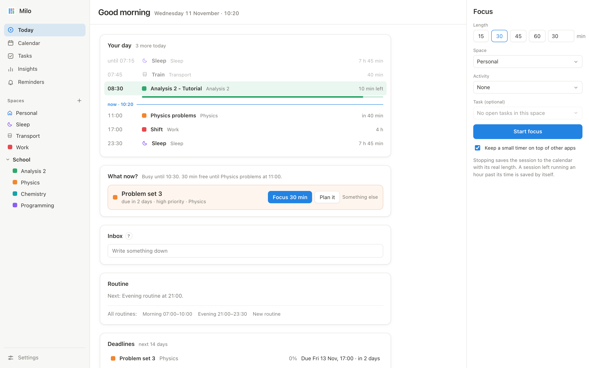
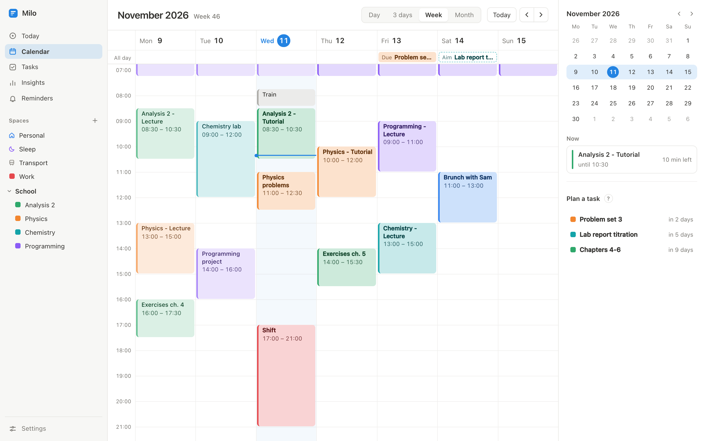
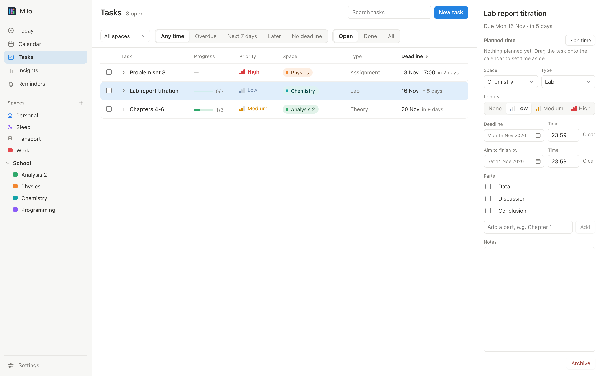
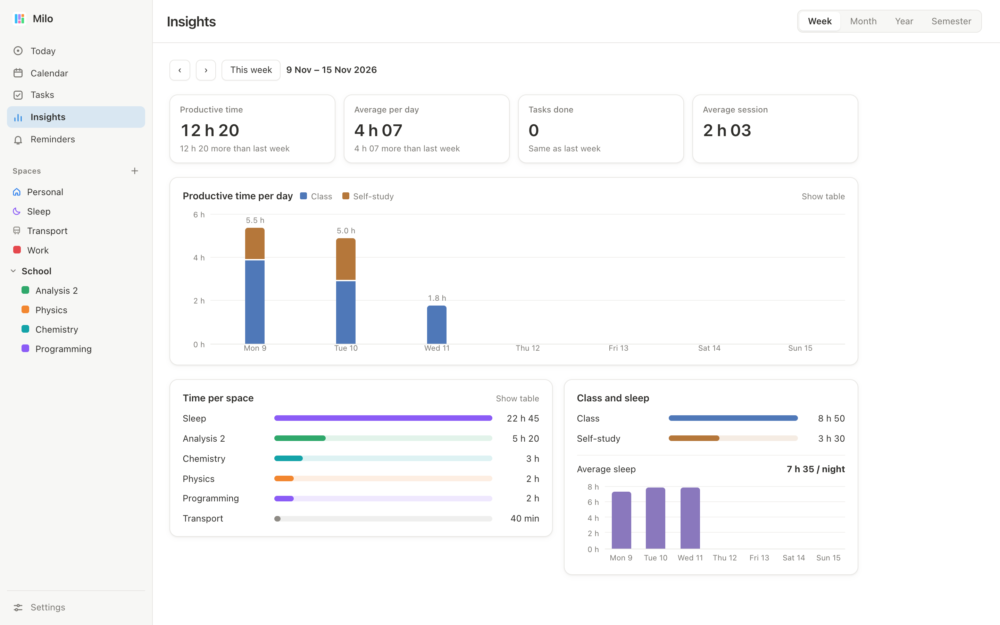
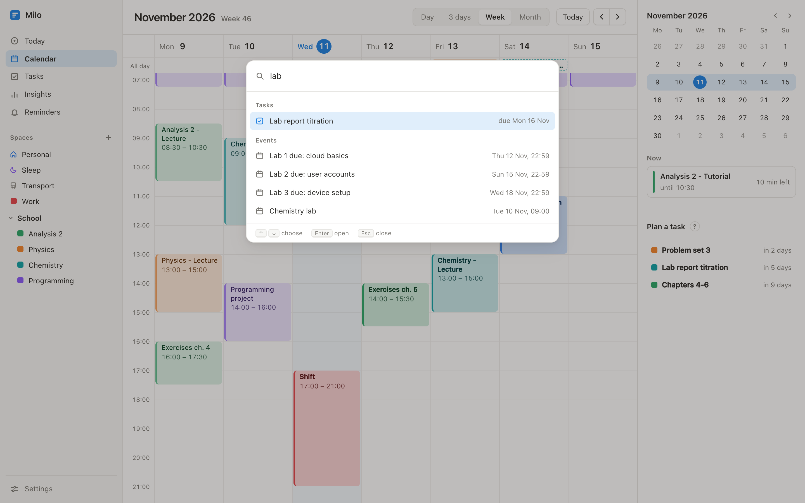
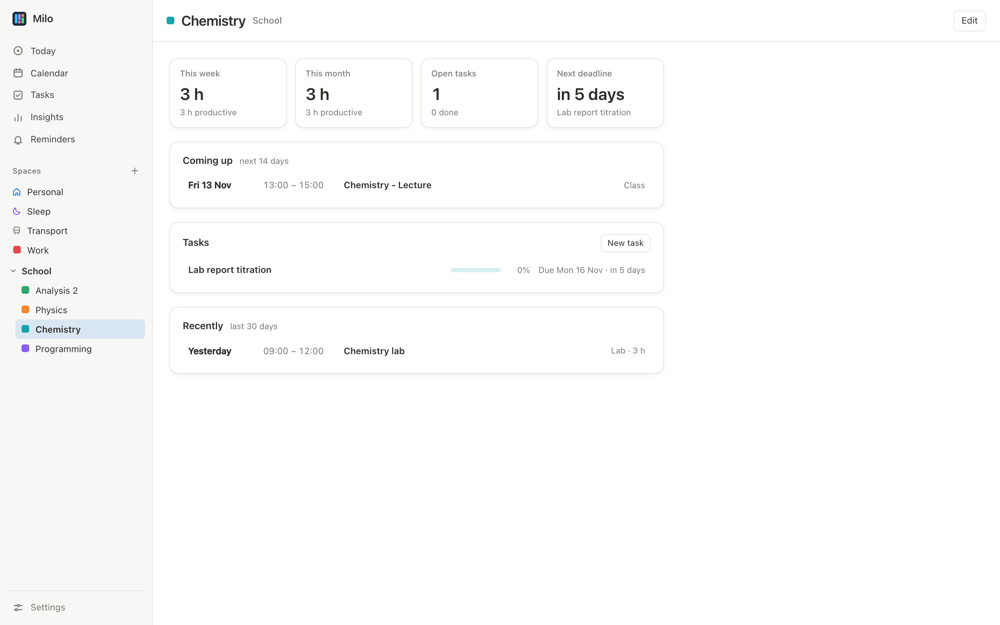

<div align="center">

<picture>
  <source media="(prefers-color-scheme: dark)" srcset="docs/screenshots/icon.png">
  
</picture>

# Milo

**A calm desktop cockpit for your week: calendar, tasks, focus and insights in one quiet place.**

Everything stays on your computer. No account, no cloud, no noise.

[](https://github.com/VR0EM/milo/releases/latest)
[](https://github.com/VR0EM/milo/actions/workflows/build.yml)


<br>

<picture>
  <source media="(prefers-color-scheme: dark)" srcset="docs/screenshots/today-dark.png">
  
</picture>

</div>

## Why Milo

Most planners compete for attention with badges, streaks, sounds and colour everywhere. Milo
does the opposite. It shows **what matters now**, keeps everything else one click away, and
stays predictable: nothing moves, beeps or celebrates on its own.

- **Calm by design.** Low visual noise, light and dark mode, no gamification, no sounds.
- **Yours, on your machine.** All data lives in one SQLite file, with a backup every day.
- **Made for a student's week.** Courses as spaces, the school timetable imported, deadlines
  and study time side by side.

## Features

<table>
<tr>
<td width="50%" valign="top">

### Today
A short list of what you chose to do today, your day as one timeline with a *now* line,
**What now?** with a single next step (or the routine that is running), deadlines and a short
look back at the end of the day.

</td>
<td width="50%" valign="top">

### Calendar
Day, 3-day, week and month views. Drag to create, move and resize; all-day events as one bar;
repeating events; events from school calendar links (iCal). Drag a task onto the hours to set
time aside for it.

</td>
</tr>
<tr>
<td colspan="2">
<picture>
  <source media="(prefers-color-scheme: dark)" srcset="docs/screenshots/calendar-dark.png">
  
</picture>
</td>
</tr>
<tr>
<td width="50%" valign="top">

### Tasks
An overview of Today, Upcoming, the Inbox and what is late, then every course with its
progress and every list. Courses have parts and task types; to-dos have steps, deadlines and
priorities. Earlier versions of a to-do can be brought back.

<picture>
  <source media="(prefers-color-scheme: dark)" srcset="docs/screenshots/tasks-dark.png">
  
</picture>

</td>
<td width="50%" valign="top">

### Insights
Productive time per day, time per space, class against self-study, and sleep. By week, month
or semester, each chart with a table view, compared with the period before, and exported as
CSV for Excel.

<picture>
  <source media="(prefers-color-scheme: dark)" srcset="docs/screenshots/insights-dark.png">
  
</picture>

</td>
</tr>
<tr>
<td width="50%" valign="top">

### Command menu
Press <kbd>⌘</kbd> <kbd>K</kbd> (<kbd>Ctrl</kbd> <kbd>K</kbd> on Windows) to go anywhere,
find a task, event or space, or type a date like *19 nov* or *fri* to jump there.

<picture>
  <source media="(prefers-color-scheme: dark)" srcset="docs/screenshots/command-dark.png">
  
</picture>

</td>
<td width="50%" valign="top">

### Spaces
Courses, work and the rest of life as spaces, grouped and colour-coded. Each space has an
overview of its time, tasks and what is coming up.

<picture>
  <source media="(prefers-color-scheme: dark)" srcset="docs/screenshots/space-dark.png">
  
</picture>

</td>
</tr>
</table>

### And also

- **Focus** with a small always-on-top timer: pick to-dos, tick them off as you go, and the calendar
  gets the time per to-do by itself.
- **Next event in the menu bar**, like *Chemistry lab in 25 min*, so time stays visible
  (on Windows: in the tray icon's tooltip).
- **Checklists from Obsidian or Notes:** paste Markdown or open a .md file; headings become
  parts, items to-dos, indented items steps.
- **Quick notes from any app** with <kbd>⌘</kbd> <kbd>⇧</kbd> <kbd>Space</kbd>; they wait in the Inbox.
- **Reminders** before events, at set times, or every so often (water, a break), and checks
  like medication taken.
- **Welcome guide** on the first start: courses, timetable link, rhythm.
- **Make it yours:** theme, accent colour, typeface, text size, 12 or 24-hour clock, first day
  of the week, which screens and Today blocks to show.
- **Updates inside the app**, only installed when you click.
- **Nothing is ever deleted:** archived items stay in the archive and can be brought back.

## Download

Get the latest version from **[Releases](https://github.com/VR0EM/milo/releases/latest)**.

| System | File |
| --- | --- |
| macOS (Apple silicon) | `Milo_x.y.z_aarch64.dmg` |
| Windows 10 and 11 | `Milo_x.y.z_x64-setup.exe` |

Milo is not signed with an Apple or Microsoft certificate yet, so the first start needs one
extra step:

- **macOS:** open the app once, then go to *System Settings › Privacy & Security* and choose
  **Open Anyway**.
- **Windows:** when SmartScreen appears, choose **More info › Run anyway**.

After that, Milo offers new versions itself (*Settings › Data & app*).

## Privacy

Milo has no account and no server. It never sends your data anywhere. It only goes online for
things you can see and switch off:

- the **calendar links** you add (to fetch your timetable or deadlines),
- the **update check**, which asks GitHub for the newest version number, and
- if you choose it, the one-time download of the **suggestion model** (about 83 MB from Hugging
  Face) that helps sort notes in the Inbox. It then runs on your computer only.

Your data is one SQLite file with daily backups next to it (and optionally a second folder):

| System | Folder |
| --- | --- |
| macOS | `~/Library/Application Support/app.milo.desktop` |
| Windows | `%APPDATA%\app.milo.desktop` |

Everything can also be exported from *Settings › Import & export*.

## Keyboard

| Keys | Does |
| --- | --- |
| <kbd>⌘</kbd> <kbd>K</kbd> | Command menu |
| <kbd>⌘</kbd> <kbd>1</kbd> … <kbd>6</kbd> | Today, Calendar, Tasks, Focus, Insights, Reminders |
| <kbd>⌘</kbd> <kbd>⇧</kbd> <kbd>Space</kbd> | Write something down, from any app |
| <kbd>⌘</kbd> <kbd>Z</kbd> | Undo the last change |
| <kbd>N</kbd> | New event or task |
| <kbd>D</kbd> <kbd>3</kbd> <kbd>W</kbd> <kbd>M</kbd> | Day, 3 days, week, month |
| <kbd>T</kbd> · <kbd>G</kbd> | Today · go to a date |
| <kbd>?</kbd> | All shortcuts |

On Windows, use <kbd>Ctrl</kbd> where this says <kbd>⌘</kbd>.

## Development

Milo is a [Tauri 2](https://tauri.app) app: a Rust backend with SQLite, and a React 19 +
TypeScript interface.

**Needs:** Node 22, the Rust toolchain, and the
[Tauri prerequisites](https://tauri.app/start/prerequisites/) for your system.

```bash
npm install
npm run tauri dev   # the desktop app, on your real data folder
npm run dev         # the interface only, in a browser, on in-memory data
```

Open the browser version with `?demo` (<http://localhost:1420/?demo>) for a sample student week.

```bash
npm test                      # the interface's logic (Vitest)
cd src-tauri && cargo test    # the data layer (Rust)
npx tsc --noEmit              # types
npm run check:layout          # every screen at three window sizes (needs npm run dev and Chrome)
```

Every push builds Milo for macOS and Windows in GitHub Actions and runs all tests there.

### Project layout

```
src/                  React interface
  features/           one folder per screen (today, calendar, tasks, insights, ...)
  components/         shared pieces (date and time fields, menus, icons)
  lib/                data access, state, time helpers, and the browser stand-in backend
src-tauri/src/        Rust backend
  db/                 SQLite schema, migrations and repair
  repo.rs             reading and writing everything
  series.rs           repeating events
  importer.rs, ics.rs calendar links
  reminders.rs        reminders and checks
  menubar.rs          the next event by the tray icon
docs/                 decisions, releasing, Windows test notes, screenshots
```

### Documentation

- [docs/DECISIONS.md](docs/DECISIONS.md): why things work the way they do
- [docs/RELEASING.md](docs/RELEASING.md): publishing a version that installed copies update to
- [docs/WINDOWS-TEST.md](docs/WINDOWS-TEST.md): testing on Windows
